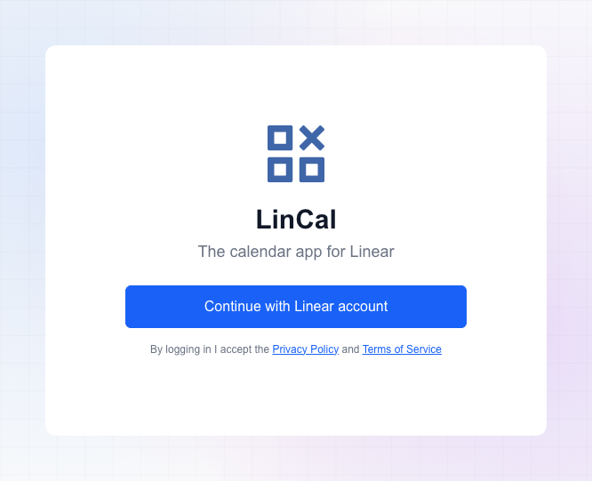
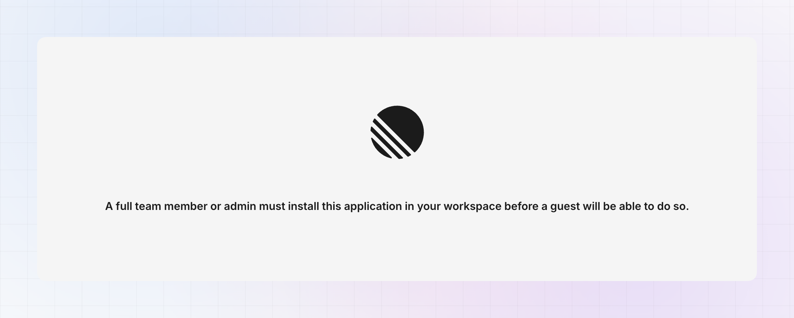

LinCal doesn't need a separate account. You sign in with Linear, and LinCal connects your workspace so you can start planning tasks on the calendar.

## Connect your account

1. Go to the login page at [lincal.app/login](https://lincal.app/login).
2. Click **Sign in with Linear**.
3. Complete the Linear sign-in flow and approve access.
4. You're redirected to LinCal, and your calendar loads.

## Troubleshooting

If you see a **"full team member or admin must install this app"** message, you are either a guest in the Linear workspace, or an admin must approve the app first. Ask your Linear workspace admin to grant access.

## Use more than one workspace

If you work in more than one Linear workspace, you can connect them all to LinCal and switch between them without signing in again.

### Connect another workspace

1. Click your name in the top bar to open the account menu.
2. Under **Workspace**, click **Connect workspace**.
3. Linear shows its consent screen. Choose the workspace you want to connect and approve access.
4. You return to LinCal with the new workspace connected.

### Switch between workspaces

1. Open the account menu in the top bar.
2. Under **Workspace**, click the workspace you want. The active workspace has a check mark.

The calendar reloads with that workspace's tasks.

### Reconnect a workspace

Sometimes LinCal loses access to a workspace, for example when the connection expires. The workspace then shows **Reconnect** next to its name in the account menu. Click it and approve access in Linear again. If the whole calendar can't load, LinCal shows a **Reconnect workspace** button.

### What's kept separate for each workspace

LinCal keeps these separately for each workspace, in your browser:

- Your [filters](/using-lincal/filtering), [Recents and Favorites](/using-lincal/recentsfavorites).
- Your [Display Options](/using-lincal/display-options).

Each workspace also has its own [plan and billing](/using-lincal/plans-and-billing).

### Share links across workspaces

A [shared calendar view](/using-lincal/share-calendar-view) belongs to the workspace it was copied from. If you open a link for another workspace you've connected, LinCal switches to that workspace. If you haven't connected it yet, LinCal asks you to connect it first.

## Log out

Open the account menu and click **Logout**. LinCal disconnects **all** connected workspaces from your account and takes you back to the login page. You sign in with Linear again to reconnect.
