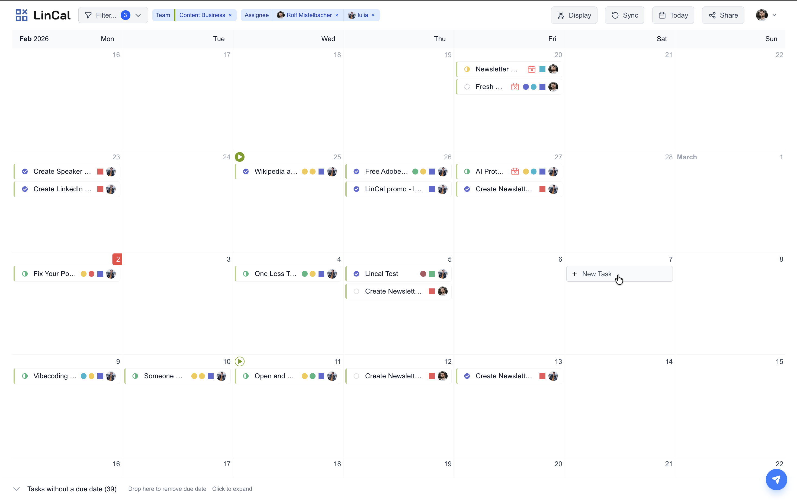
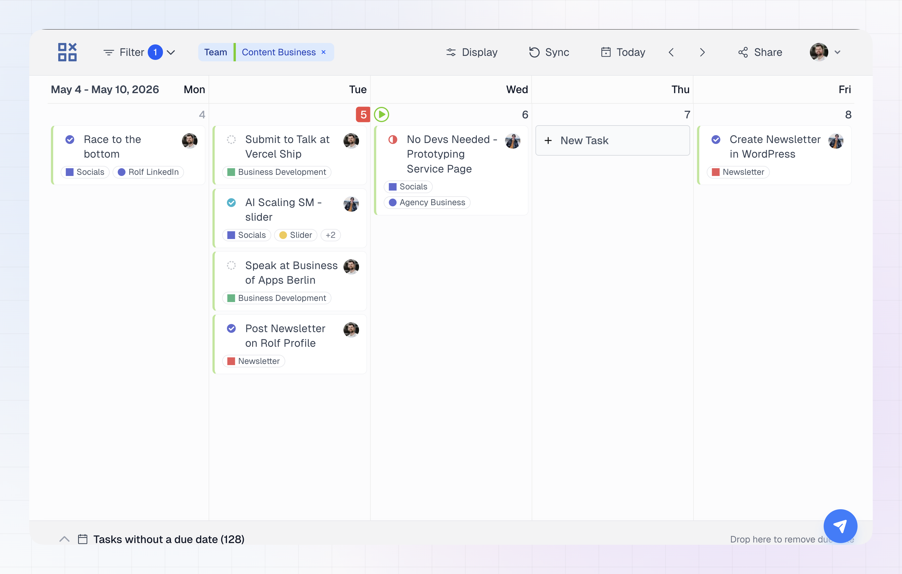

LinCal shows your Linear issues by due date on a calendar. You can use **month view** for a dense overview or **week view** for larger cards and more detail per task.
## Calendar layout

## Month view

Month view stacks calendar **rows vertically** so you can scan many weeks at once.

- **Scroll** (or trackpad) to move **up and down** through the calendar.
- Each day shows up to **four** issues directly. If there are more, use **“x more”** to open the full list for that day.
- The header’s **month label** updates as you move through the calendar.

## Week view

Week view shows **one week at a time** in a wide layout.

- **Scroll horizontally** (or use the toolbar arrows) to move to the previous or next week.
- **All** issues for a day are listed in the column—there is no four-issue cap.
- Task cards are **taller** and show **more information in text** where month view uses compact icons or dots—for example **project name** and **label names** as chips (subject to your Display settings).
- **Overdue** issues show a clearer on-card label in week view (for example how long they’re overdue).

## Switch between month and week

**From the UI**

1. Open **Display** in the top bar.
2. Under **Calendar view**, choose **Month** or **Week**.

**From the keyboard**

- **M** — month view  
- **W** — week view  

## Move through the calendar

**Today**

- Click **Today** in the toolbar, or press **T**.

**Toolbar**

- In **month view**, the arrows move the calendar **one screen** vertically (same idea as paging up/down).
- In **week view**, the arrows move **one week** left or right.

**Arrow keys**

| View   | Previous | Next   |
|--------|----------|--------|
| Month  | ↑        | ↓      |
| Week   | ←        | →      |

## Top bar reminders

Alongside **Display**, the top bar includes **Filter**, icons for **Sync**, **Today** and **Share**, and your account menu. Use them to narrow tasks, refresh from Linear, jump to today, or share your current setup.

## Task cards and Display options

What you see on each card depends on your **Display** settings. Month view keeps cards compact, and week view shows more written detail.

Click a task card to open it in LinCal for quick edits, or **Cmd-click** (Mac) / **Ctrl-click** (Windows/Linux) to open the issue in Linear in a new tab. **Overdue** issues are highlighted on the card.

To change which properties appear, how tasks are ordered, or what's hidden, see [Display Options](/using-lincal/display-options).

## Tasks without a due date

The bar at the bottom of the calendar lists tasks that don't have a due date yet, so you can still see and work with them. Click the bar to expand it, and drag a task onto a day to schedule it.

See [Tasks Without a Due Date](/using-lincal/tasks-without-due-date) for how to search the bar and which tasks it shows.
