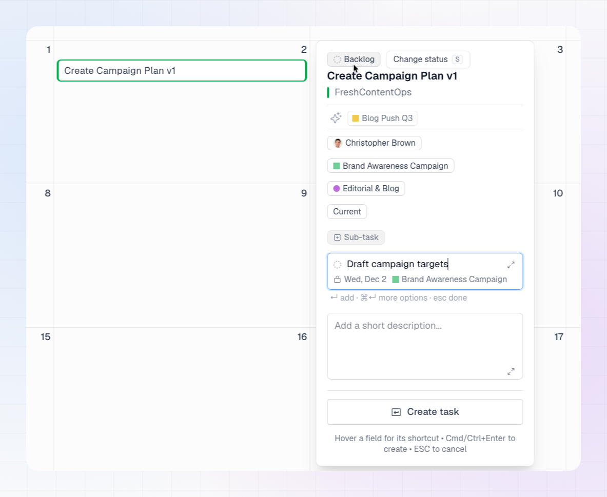
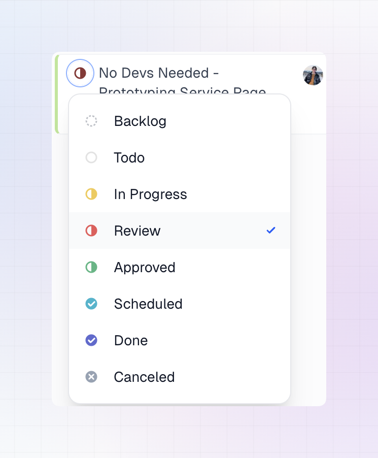

You can create and edit Linear tasks without leaving the calendar. Everything you do syncs to Linear right away.

## Create a task

1. Hover a day cell and click **New Task**, or press **C**.
2. Type the task title straight into the day cell and press **Enter**.
3. Choose a team if LinCal asks. This step is skipped when your filters already point to a single team.
4. On the **Task Properties** step, optionally set:
   * **Status**
   * **Assignee**
   * **Project**
   * **Labels**
   * **Cycle**
   * **Description**
   * **Sub-tasks** (see [Sub-tasks](#sub-tasks))
5. Click **Create task**, or press **Cmd+Enter** (Mac) / **Ctrl+Enter** (Windows/Linux).

Press **Esc** to cancel at any point.

The task is created in Linear and appears on the day you picked.

### Quick-add suggestions

When you choose a team, LinCal suggests the assignees, projects and labels you've used most recently for that team. Click a suggestion to apply it, or dismiss the ones you don't want. This makes repeat work, like creating a series of tasks for the same project, much faster.

### Set properties from the keyboard

When the task window is open, press a key to jump to a property:

| Key | Property |
| --- | --- |
| **S** | Status |
| **A** | Assignee |
| **P** | Project |
| **L** | Labels |
| **Shift+C** | Cycle |
| **D** | Description (when creating) |
| **Cmd/Ctrl+Shift+O** | Add a sub-task |

Use **↑** / **↓** to move through the options and **Enter** to select. See [Keyboard Shortcuts](/using-lincal/keyboard-shortcuts) for the full list.

## Sub-tasks

You can add sub-tasks when you create a task, or add them to a task that already exists.

### Create a task with sub-tasks

1. Start a new task and enter the title.
2. On the **Task Properties** step, click **Sub-task**, or press **Cmd/Ctrl+Shift+O**.
3. Type a sub-task title and press **Enter**. Repeat to add more.
4. To set details on a sub-task, click it in the list. Click the **x** next to it to remove it.
5. Click **Create task**. LinCal creates the task and all its sub-tasks together.

You can add up to 50 sub-tasks to a new task.

### Add sub-tasks to an existing task

1. Click the task card to open it.
2. Click **Sub-task**, or press **Cmd/Ctrl+Shift+O**.
3. Type a title and press **Enter**. The sub-task is created right away, and you can keep typing to add the next one.
4. For the full form, press **Cmd/Ctrl+Enter** or click the expand icon.
5. Press **Esc** to close the row.

If a sub-task fails to create, it stays in the list with a **Retry** button.

### What a new sub-task inherits

A new sub-task copies some values from its parent, the same way Linear does:

| Value | Rule |
| --- | --- |
| **Team** | Always the parent's team. |
| **Due date** | Always the parent's due date. |
| **Project** | Always the parent's project. |
| **Assignee** | Copied only if the parent is assigned to you, or all of the parent's existing sub-tasks share the parent's assignee. |
| **Cycle** | Copied only when the sub-task's status is unstarted or started. |
| **Labels** | Never copied. |

The quick-add row shows the due date, assignee and project the sub-task will get before you press **Enter**.

### Find and move sub-tasks

- **Task window:** a task's window lists its sub-tasks with their status, ID, title, assignee and due date. Click one to open it, and use the back link to return to the parent.
- **Calendar:** sub-tasks are hidden by default. Turn on **Show sub-tasks** in [Display Options](/using-lincal/display-options) to see them as cards.
- **Rescheduling:** drag a sub-task to another day to change its due date. See [Drag and Drop](/using-lincal/drag-and-drop).
- **Nesting:** you can add sub-tasks to any sub-task.

## Edit a task

1. **Click** a task card to open **Task Properties**.
2. To open the issue in **Linear** in a new tab instead, **Cmd-click** (Mac) or **Ctrl-click** (Windows/Linux) the card.
3. Change the title, status, assignee, project, labels or cycle. Changes **sync to Linear automatically**. There's no Save button.
4. Click **Open in Linear** when you need the full issue, including long descriptions, attachments and comments.
5. Press **Esc** to close the panel.

Click the task identifier to copy the link to the task in Linear.

## Change status from the card

1. Click the **status** control on the left of the task card.
2. Pick a new status.
3. The card updates right away.

The available statuses come from the task's team workflow in Linear. You can also press **S** in the task window to change status from the keyboard.
