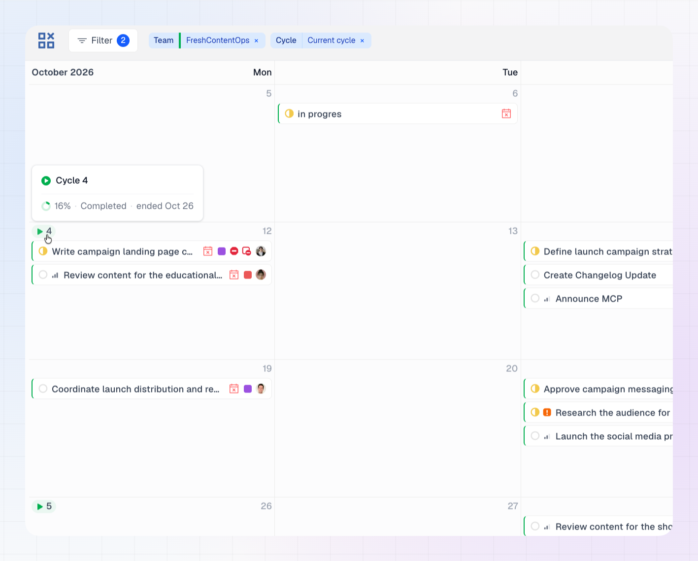

When you view a single team, LinCal marks the start of each of that team's Linear cycles on the calendar. This helps you see where one cycle ends and the next begins while you plan tasks.

## Cycle pills

A cycle pill shows a small play icon and the **cycle number**. It appears on the day the cycle starts. Each pill uses your team's color from Linear.

The calendar shows pills for the team's past, current and upcoming cycles, so you can scroll back and forward and see every cycle start.

## Hover for details

Hover a pill to see:

- The cycle name, for example **Cycle 12**
- Progress as a percentage
- Whether the cycle is **Current**, **Upcoming** or **Completed**
- How long is left: "4 days left" for a current cycle, "6 days to start" for an upcoming one, or "ended Mar 14" for a completed one

{/* TODO: screenshot of the hover card */}

## Open a cycle in Linear

Click a pill, or the cycle name in the hover card, to open the cycle in Linear in a new tab.

## When cycle pills appear

Cycle pills appear when **exactly one team is selected** in the [Teams filter](/using-lincal/filtering). They don't appear when:

- No team is selected.
- Two or more teams are selected, because cycles from different teams could overlap and be confusing.
- The selected team has no cycles. If the team is a sub-team without cycles of its own, LinCal shows the cycles of its parent team instead.

## Show only a cycle's tasks

Cycle pills show you *when* a cycle runs. To see only the tasks in a cycle, use the **Cycles** filter. It includes **Current** and **Upcoming** options. See [Filtering](/using-lincal/filtering).
