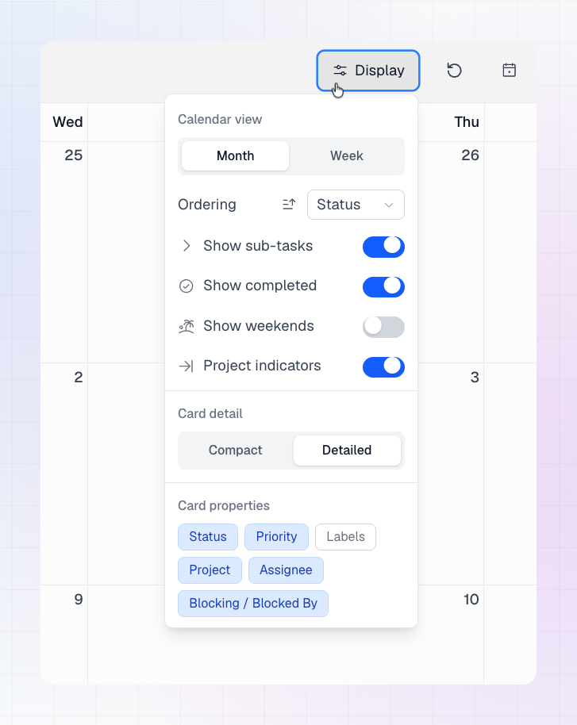

The **Display** menu in the top bar controls how your calendar looks. Changes apply immediately and don't change anything in Linear.

## Calendar view

Choose **Month** or **Week**. You can also press **M** or **W** on your keyboard.

Month view is compact and shows many weeks at once. Week view gives you larger cards with more detail. See [Calendar View](/using-lincal/calendar-view) for how each view works.

## Ordering

Ordering controls how tasks are sorted inside each day.

1. Open **Display**.
2. Next to **Ordering**, pick what to sort by:
   - **Status**
   - **Updated**
   - **Priority**
3. Click the arrow icon next to it to switch between **ascending** and **descending**.

By default, tasks are sorted by **Status, descending**.

## Card detail

**Card detail** switches how much information month view shows on each card:

- **Compact** (default): small cards with icons and dots, so you can see more tasks at a glance.
- **Detailed**: larger cards with more written information.

This option only appears in month view. Week view always uses detailed cards.

## Card properties

Card properties decide what appears on each task card. Click a property to turn it on or off.

| Property | Shows | Default |
| --- | --- | --- |
| **Status** | The task's workflow status. Click it on the card to change it. | On |
| **Priority** | The task's priority. | Off |
| **Labels** | The task's labels. | On |
| **Project** | The project the task belongs to. | On |
| **Assignee** | The person the task is assigned to. | On |
| **Blocking / Blocked By** | Whether the task blocks other tasks or is blocked by them. | On |

### Blocking and blocked by

When a task has dependencies in Linear, its card shows an icon. On detailed cards it also shows how many related tasks there are. Hover the icon to see the list of related tasks.

## Project indicators

Turn on **Project indicators** to show your Linear projects on the calendar as start and target pills. Turn it off if you want a calendar with only tasks. See [Projects on the Calendar](/using-lincal/projects-on-calendar) for what the pills show and which projects appear.

## Show or hide tasks

These toggles control which tasks appear on the calendar:

| Toggle | What it does | Default |
| --- | --- | --- |
| **Show sub-tasks** | Shows sub-tasks as their own cards. | Off |
| **Show completed** | Shows tasks with a completed or canceled status. | Off |
| **Show weekends** | Shows Saturday and Sunday columns. | On |

<Tip>
If a task is missing from your calendar, check these toggles first. See [Task Loading and Visibility](/using-lincal/task-load-visibility) for other reasons a task might not appear.
</Tip>

## Good to know

- Display options are saved, so your calendar looks the same the next time you open it.
- When you [share a calendar view](/using-lincal/share-calendar-view), the link includes your display options.
- Display options change only how LinCal looks. They never edit tasks in Linear.