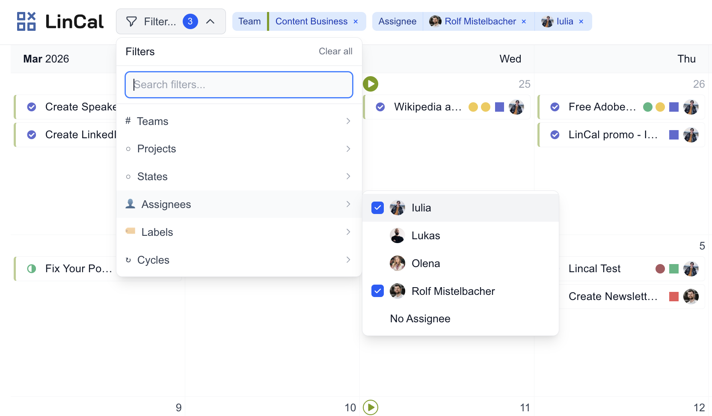

## Open filters

- Click **Filter...** in the top bar.
- Use **⌘K** (or **Ctrl+K**) to open filters quickly.
- Use the search field to find filter options fast.

## Available filter types

You can filter by:

- Teams
- Projects
- Statuses
- Assignees
- Labels
- Cycles
- [Views](/using-lincal/views)

### Notes

- Team options are grouped into **Your teams** and **Other teams**.
- Label filters support grouped labels and **No Label**.
- Assignee and project filters include **No Assignee** and **No Project** options where relevant.
- Cycle filters include semantic options like **Current** and **Upcoming** when available.
- The projects, cycles and labels you can pick depend on your other filters. With no team selected you see the ones from your own teams, and selecting a team shows that team's options.
- Project and cycle dates also appear on the calendar. See [Projects](/using-lincal/projects-on-calendar) and [Cycles](/using-lincal/cycles-on-calendar).

## Manage active filters

- Active filters appear as chips next to the filter button.
- Remove a single filter value with the **x** on its chip.
- Click **Clear all** inside the filter menu to reset everything.

## While filtering

- The calendar updates immediately as you select options.
- Hovering a filter chip highlights matching cards and dims non-matching cards.
- Selected filters are remembered for your account/workspace, so your view stays consistent between sessions.