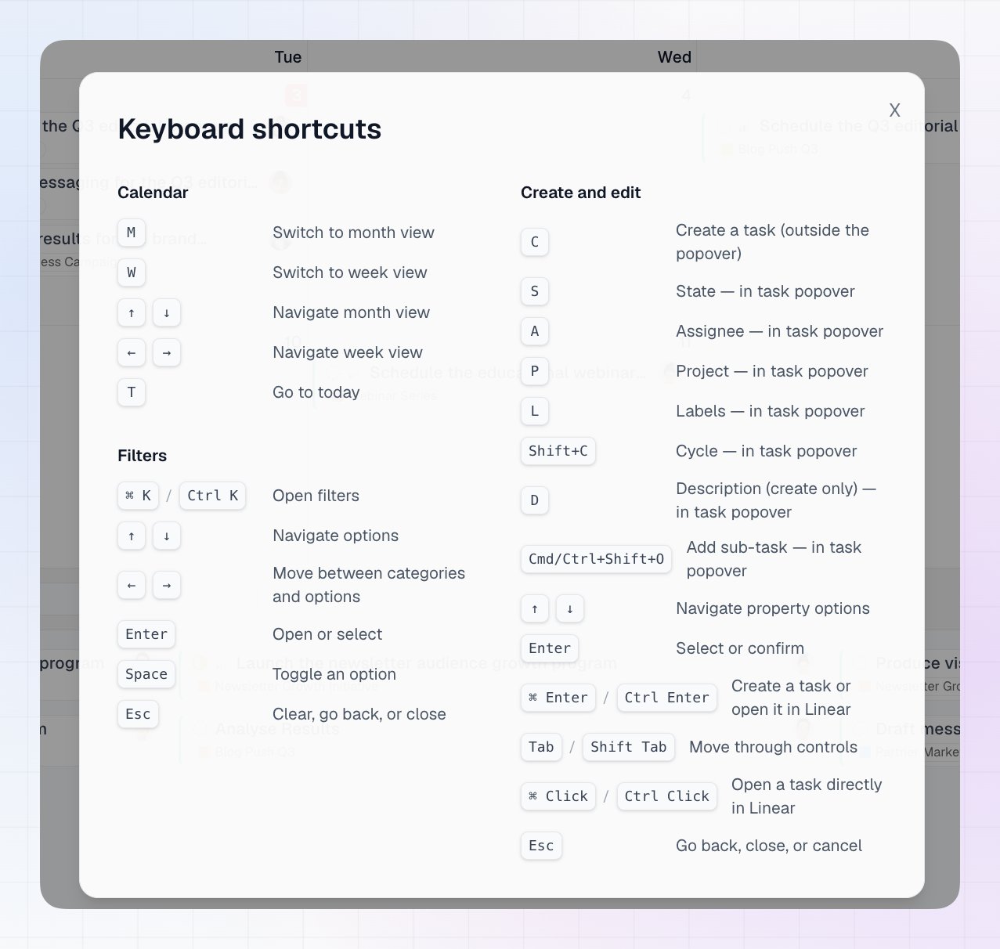

LinCal is built to be used from the keyboard. This page lists every shortcut. You can also see them inside the app from the **Help & Resources** button in the top bar.

<Note>
On Windows and Linux, use **Ctrl** wherever a shortcut says **Cmd**.
</Note>

{/* TODO: replace with a screenshot of the in-app Keyboard shortcuts window */}

## Calendar

| Shortcut | Action |
| --- | --- |
| **M** | Switch to month view |
| **W** | Switch to week view |
| **T** | Go to today |
| **↑** / **↓** | Move through the calendar in month view |
| **←** / **→** | Move to the previous or next week in week view |

See [Calendar View](/using-lincal/calendar-view) for more on moving through the calendar.

## Filters

| Shortcut | Action |
| --- | --- |
| **Cmd+K** | Open filters |
| **↑** / **↓** | Move through options |
| **←** / **→** | Move between categories and options |
| **Enter** | Open or select |
| **Space** | Toggle an option |
| **Esc** | Clear, go back, or close |

See [Filtering](/using-lincal/filtering) for more on filters.

## Creating and editing tasks

### Start a task

| Shortcut | Action |
| --- | --- |
| **C** | Create a task |

### In the task window

When the task window is open, press a letter to jump to that property.

| Shortcut | Action |
| --- | --- |
| **S** | Status |
| **A** | Assignee |
| **P** | Project |
| **L** | Labels |
| **Shift+C** | Cycle |
| **D** | Description (when creating a task) |
| **Cmd+Shift+O** | Add a sub-task |

### Moving and confirming

| Shortcut | Action |
| --- | --- |
| **↑** / **↓** | Move through the options of a property |
| **Enter** | Select or confirm |
| **Tab** / **Shift+Tab** | Move through controls |
| **Cmd+Enter** | Create the task, or open it in Linear when editing |
| **Cmd+Click** | Open a task card directly in Linear |
| **Esc** | Go back, close, or cancel |

See [Creating Issues](/using-lincal/creating-issues) for the full task creation and editing flow.