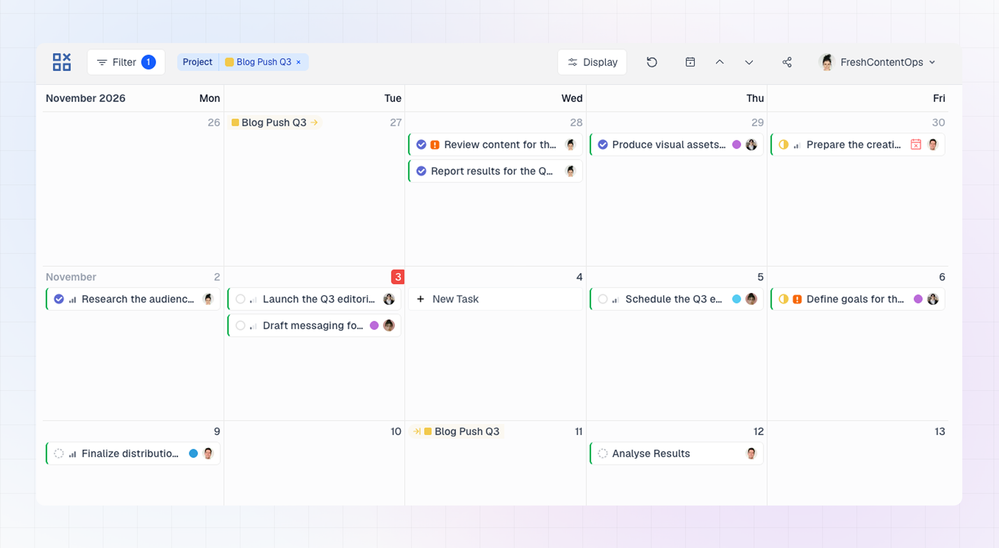

LinCal shows your Linear projects on the calendar as **pills** on the day a project starts and on the day it's due. This lets you plan tasks around project dates without leaving the calendar.

## Start and target pills

A project can have up to two pills:

- **Start pill:** appears on the project's start date. It has an arrow after the project name.
- **Target pill:** appears on the project's target date. It has a line-and-arrow icon before the project name.
- **Single pill:** if a project starts and ends on the same day, you see one pill instead of two.

Each pill uses the project's color from Linear.

If several projects land on the same day, the pills get smaller to fit. The first one keeps its name, the others shrink to icons, and any extra ones are grouped behind an overflow button. Hover the overflow button to see the full list.

## Hover for details

Hover a pill to see:

- The project name
- Progress as a percentage
- The date range, from start date to target date
- How far away the date is, for example "starts in 3 days" or "ended 2 days ago"
- The project status
- The project lead, if there is one

If a project's dates are set by quarter, half year or year in Linear, the hover shows them the same way, for example "Q3 2026".

## Open a project in Linear

Click a pill, or the project name in the hover card, to open the project in Linear in a new tab.

## Which projects appear

Project pills are **on by default**, but they only appear once you've narrowed the calendar:

- **Select a team** in the filter, and pills appear for that team's projects.
- **Select specific projects** in the Projects filter, and pills appear for those projects, even if they belong to other teams.

With no team or project selected, no pills show.

A project is left out when:

- It has **no start date and no target date**.
- Its status is **Canceled**.

Completed projects still appear.

### Projects in the filter list

The projects you can pick in the Projects filter depend on your other filters:

- **No filters:** projects from your own teams.
- **A team selected:** projects from that team.
- **An assignee selected, but no team:** projects from all teams in the workspace.

## Turn project pills on or off

Open **Display** and use the **Project indicators** toggle. It's on by default. See [Display Options](/using-lincal/display-options) for the other calendar options.
